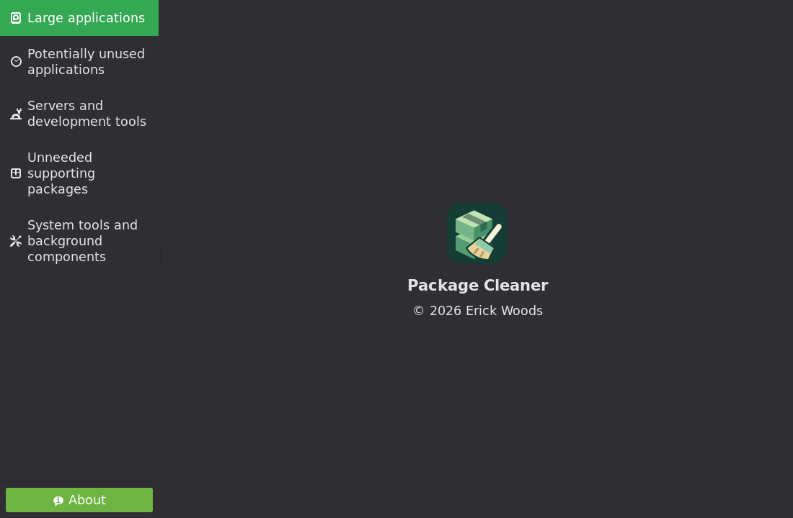

# Package Cleaner

A GTK and CLI utility for Linux Mint that helps identify and safely remove unnecessary APT and Flatpak software.

Package Cleaner helps you examine installed applications, investigate potentially unnecessary software, understand the consequences of removal, and make informed cleanup decisions. It organizes software into useful categories and previews proposed changes before you approve them.

Written in Python, with a native GTK interface and an interactive terminal interface. This is an early public release: review proposed changes carefully and maintain backups before removing software.



## Features

- Native GTK desktop interface and guided interactive CLI.
- APT and Flatpak discovery, including separate Flatpak installations.
- Large applications, potentially unused applications, servers/development tools, supporting packages, and system-component investigation.
- Global GTK search, source filtering, numeric size sorting, and available observed-activity sorting.
- Persistent Keep preferences shared by both interfaces.
- Persistent GTK removal queue; terminal selections remain session-local.
- Dependency-aware previews, critical-system protection, explicit approvals, and fresh transaction validation.
- Verified execution results, concise execution logs, and separate compressed audit evidence.
- Optional detailed diagnostics for experienced users.

## Supported environment

Developed and tested on **Linux Mint 22.3 Cinnamon**, using the system Python 3 and GTK 3. The APT backend targets the standard Debian/Ubuntu package-management layout. Other distributions, custom APT roots/configurations, and desktop environments have not been validated; Debian/Ubuntu compatibility is a design direction, not a support guarantee.

Version **0.1.0** is a pre-release. A `.deb` installer and source archives are available on the [releases page](https://github.com/woodpile72/PackageCleaner/releases). There is no PyPI distribution. Do not run the GUI as root.

## Requirements

Use `/usr/bin/python3`, so distro-provided bindings are available. Python 3.10 or newer is required by the source syntax; development uses Mint's Python 3.12.

| Purpose | System packages / facilities |
| --- | --- |
| APT inventory and execution | `python3-apt`, APT and dpkg tools |
| GTK interface | `python3-gi`, `gir1.2-gtk-3.0`, SVG loader (`librsvg2-common`), desktop display/session |
| Flatpak support | `flatpak`, `gir1.2-flatpak-1.0`, `python3-gi` |
| APT authorization | `sudo`; GUI execution also requires a supported system askpass program |
| Flatpak system authorization | Working desktop polkit authentication agent, when authorization is required |
| Source checkout | `git` |

Use Mint's package manager to install missing dependencies. Package Cleaner never installs them automatically. No pip dependencies are required. Optional systemd/journal and socket observations depend on available tools and permissions; inaccessible history reduces evidence coverage.

Graphical APT authentication currently searches for root-owned, non-writable executables at `/usr/bin/ssh-askpass`, `/usr/lib/openssh/ssh-askpass`, `/usr/lib/ssh/ssh-askpass`, `/usr/bin/ksshaskpass`, and `/usr/bin/kdesvnaskpass`. If none are available, use the terminal interface or configure an appropriate system-provided askpass package. Package Cleaner does not collect passwords.

## Install the Debian package

Download `package-cleaner_0.1.0_all.deb` and `SHA256SUMS` from the [v0.1.0 pre-release](https://github.com/woodpile72/PackageCleaner/releases/tag/v0.1.0). In the download directory:

```sh
sha256sum -c SHA256SUMS
sudo apt install ./package-cleaner_0.1.0_all.deb
```

Review APT's proposed changes before confirming. The `all` architecture package contains Python and SVG assets, not native compiled code. It targets Linux Mint 22.3; installation on other Debian-derived distributions is not a compatibility guarantee.

Launch **Package Cleaner** from the application menu, or use `package-cleaner gui` / `package-cleaner` in a terminal. The installer supplies the desktop entry, icon, manual pages and root-owned application code. It does not run cleanup, add services or change sudoers. Keep preferences and queue data remain in your user's XDG directories. To uninstall the utility itself, use `sudo apt remove package-cleaner`; user preferences and logs are retained.

## Install from source

```sh
git clone https://github.com/woodpile72/PackageCleaner.git
cd PackageCleaner
./package-cleaner --help
```

Keep the checkout in a location you control. APT execution runs the checkout's privileged helper through sudo, so only execute a source tree you trust. There is no setuid installation or background privileged daemon.

### GTK

```sh
./package-cleaner gui
```

The independent launcher also works:

```sh
./package-cleaner-gui
```

The default command still launches the terminal menu. The desktop-launcher template is `data/org.packagecleaner.Review.desktop`. To add it to your user menu, copy it to `~/.local/share/applications/`, then edit `Exec` to the absolute path of this checkout's `package-cleaner-gui` and `Icon` to the absolute path of `data/package-cleaner.svg`. Quote the executable path if it contains spaces. The template's short names require corresponding PATH/icon-theme installation and are not automatically installed by cloning.

### Terminal

```sh
./package-cleaner
./package-cleaner search apache
./package-cleaner scan --category large
./package-cleaner scan --category advanced --component-filter investigate
./package-cleaner ignored list
```

Review keys: **K** Keep permanently, **R** queue/review removal, **S** Skip, **P** Previous, **D** Details, **T** advanced package information, **F** Finish, **Q** Quit. Pagination uses **N** for Next set.

The terminal defaults to read-only review. To offer execution after validation:

```sh
./package-cleaner --enable-removal
```

The CLI requires an exact `REMOVE` confirmation for each transaction. GTK uses a separate final Cancel/Remove dialog; no CLI opt-in flag is required for that graphical flow. Queuing alone never authorizes removal.

## Queues, previews, and removal

1. Browse categories or search. **Keep permanently** suppresses recommendations; explicit search can still inspect kept or protected software.
2. **Queue Removal** in GTK records your intention. It does not simulate or authorize execution. The CLI's **R** also requests a preview.
3. **Review cleanup queue** validates the combined GTK selection and explains affected software, supporting packages and warnings.
4. **Remove Selected Software** reconstructs and validates proposals. Confirm each provider/Flatpak installation separately. Changed proposals require approval again.
5. Read the verified result. Incomplete or uncertain outcomes stop the sequence; do not blindly retry.

APT uses its own resolver. Previously eligible autoremove packages are kept separate from application-specific removals. The final explicit transaction disables global autoremove and must pass protection and manual-selection checks. Shared dependencies remain installed when required. Software grouping is not blanket approval to remove every package in a stack.

Flatpak previews resolve exact refs per installation. Unused runtimes/extensions can be investigated separately; they are not silently added to application removal. Application data is retained. Installed-byte totals are upper bounds on possible recovery because OSTree storage is shared.

Keep preferences normally live in `~/.config/package-cleaner/preferences.json`; the GTK queue and execution logs live below `~/.local/state/package-cleaner/`. XDG overrides are supported. Use `ignored remove <identifier>` or `ignored clear` to reset Keep choices; clearing preferences never changes installed packages. Runtime evidence can contain local paths and package inventories: inspect and redact it before sharing.

## Safety and limitations

The safeguards reduce risk; they cannot promise absolute safety.

- Inactivity detection is imperfect. Missing history is **not** evidence of non-use. Executable access timestamps are weak clues, not execution records. A running/enabled service is not proof that someone uses it. Log rotation, permissions and incomplete history limit conclusions.
- Flatpak currently has no reliable historical usage source. Unknown usage is not classified as inactivity. Classification cannot identify every local script, plugin, dynamically loaded dependency or manually installed consumer.
- Installed application footprint is **not** recoverable disk space. APT estimates are calculated during validated previews; shared dependencies, configuration files and Flatpak runtimes/storage complicate actual recovery.
- Protected system/desktop packages are blocked. Unselected manual APT packages require explicit selection. Execution revalidates state and operations; missing validation capabilities fail closed.
- APT removal can run maintainer scripts and hooks with administrator privileges. Their side effects are not fully predicted by a simulation. Backups and human review remain essential.
- APT and Flatpak installations are **separate transactions without atomic rollback**. Earlier successful removals are not undone if a later transaction fails.
- A successful package-manager return alone is insufficient. Completion requires verified results and independently observed final state. Unexpected changes or communication failures can produce an unknown result requiring reconciliation.
- GTK can cancel supported Flatpak work and then verify actual state. Once the APT helper starts, cancellation is not offered. Closing during execution offers background completion; a stuck external operation is not forcibly killed or retried.

Some libflatpak/PyGObject combinations emit a `G_VALUE_HOLDS_FLAGS` warning for the operation-completion signal. Tests reproduce the metadata mismatch without a real transaction; success does not rely on those informational flags. Warnings are not globally suppressed. Desktop accessibility-bus failures should be diagnosed as session problems rather than disabling accessibility.

## Development and tests

See [CONTRIBUTING.md](CONTRIBUTING.md) for architecture and contribution expectations.

No build step is needed. From the checkout:

```sh
/usr/bin/python3 -m unittest discover -s tests -q
```

Native GTK tests are opt-in and require a display. They use fake package/execution backends:

```sh
PACKAGE_CLEANER_GTK_TESTS=1 /usr/bin/python3 -m unittest discover -s tests -q
```

The automated suite must never remove real software. GTK tests can open transient windows; use a disposable desktop session when convenient. CI runs the ordinary suite and native tests under Xvfb on Ubuntu 24.04. CI is not proof that real authorization or removal works on every desktop; it does not perform real package removals.

## Contributing

Bug reports and pull requests are welcome through [GitHub Issues](https://github.com/woodpile72/PackageCleaner/issues) and pull requests. Include steps to reproduce, environment information and relevant redacted diagnostics. Keep core rules separate from presentation, preserve existing safeguards, and add regression tests. Do not submit private inventory snapshots or credentials.

## License

Copyright © 2026 Erick Woods.

Package Cleaner source, documentation and original application artwork are licensed under the **GNU General Public License version 3 only** (`GPL-3.0-only`). See the complete [LICENSE](LICENSE). External system libraries and icon themes retain their own licenses; they are not bundled. See [third-party notes](docs/THIRD_PARTY.md).
